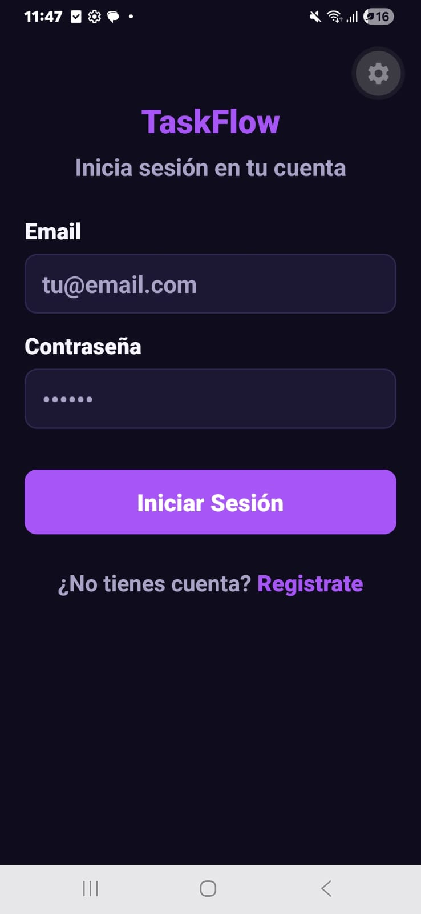
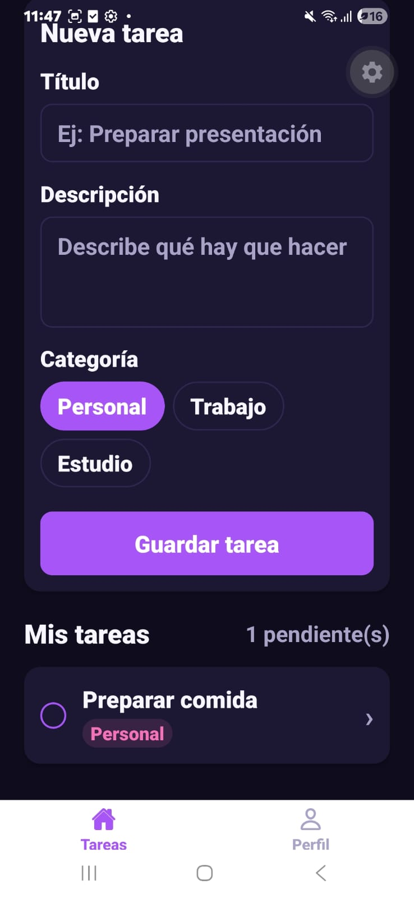
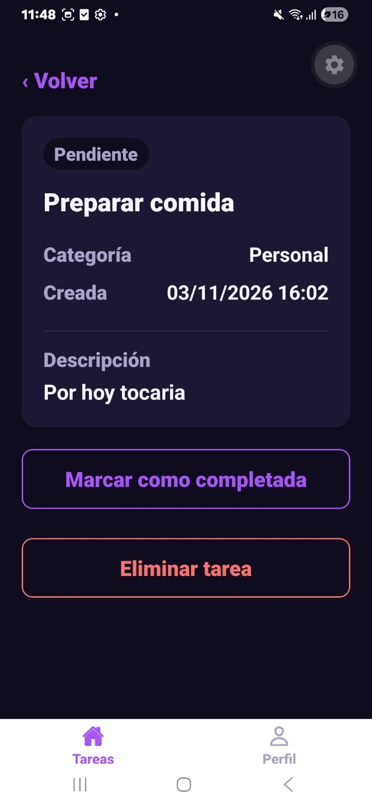
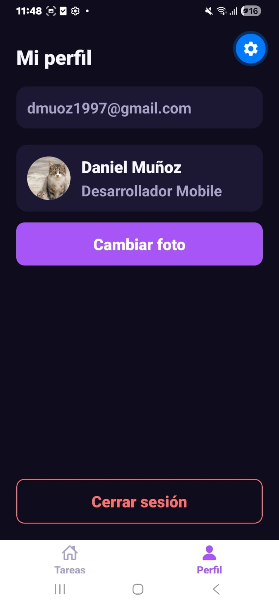

# TaskFlow

Aplicación móvil de gestión de tareas con React Native y Expo. Cada usuario tiene sus propias tareas y su foto de perfil, sincronizadas en la nube con Firebase.

## Características

- Registro e inicio de sesión con email y contraseña (Firebase Auth)
- Sesión persistente: al reabrir la app seguís logueado
- Crear, completar, ver detalle y eliminar tareas (Firestore, en tiempo real)
- Tareas separadas por usuario
- Perfil con foto tomada de la galería (expo-image-picker), reducida y guardada en Firestore
- Estado global con Redux Toolkit
- Navegación con Bottom Tabs (Tareas, Perfil) y Stack (lista, detalle, formulario, login)

## Requisitos

- Node.js 20 o superior
- App **Expo Go** instalada en tu teléfono (Android o iOS)
- Un proyecto de Firebase con Authentication y Firestore habilitados

## Instalación

```bash
npm install
```

### Configurar Firebase

1. Copiá el archivo de ejemplo:
   ```bash
   cp .env.example .env
   ```
2. En Firebase Console → Configuración del proyecto → Tus apps, copiá los valores de `firebaseConfig` y completá cada variable en `.env`.
3. Habilitá **Authentication → Email/Password**.
4. Creá la base de datos **Firestore** y pegá estas reglas en *Rules*:
   ```
   rules_version = '2';
   service cloud.firestore {
     match /databases/{database}/documents {
       match /tasks/{taskId} {
         allow read, update, delete: if request.auth != null && resource.data.userId == request.auth.uid;
         allow create: if request.auth != null && request.resource.data.userId == request.auth.uid;
       }
       match /users/{userId} {
         allow read, write: if request.auth != null && request.auth.uid == userId;
       }
     }
   }
   ```

El archivo `.env` no se sube al repositorio (está en `.gitignore`), por eso hay que crearlo en cada copia del proyecto. Las variables `EXPO_PUBLIC_*` quedan incluidas en el bundle de la app, así que no son secretas en sentido estricto: la seguridad real la dan las reglas de Firestore.

### Ejecutar

```bash
npx expo start
```

Escaneá el código QR con Expo Go (Android) o con la cámara (iOS). Para ver cambios en vivo, dejá la terminal abierta.

## Estructura

```
src/
├── components/     Componentes reutilizables (TaskItem, TaskForm, ProfileCard, ...)
├── config/         Inicialización de Firebase (Auth, Firestore)
├── constants/      Paleta de colores, degradados y espaciados
├── navigation/     Navegadores: Auth, Tabs y Stack de tareas
├── screens/        Pantallas
├── services/       Acceso a Firestore (tareas y avatar)
└── store/          Redux Toolkit: store y slices de auth y tareas
```

## Modelo de datos

```
tasks/{taskId}
├── userId        (string)  uid del dueño
├── title         (string)
├── description   (string)
├── category      (string)  Personal | Trabajo | Estudio
├── completed     (boolean)
└── createdAt     (string, ISO 8601)

users/{uid}
└── avatarData    (string)  Foto de perfil como data URI JPEG (256 px)
```

## Capturas

| Login | Lista de tareas | Detalle | Perfil |
|---|---|---|---|
|  |  |  |  |

## Build y publicación

Para compartir la app con Expo Go hay que publicar una actualización:

```bash
npx eas-cli@latest login
npx eas-cli@latest init
npx eas-cli@latest update --branch production --message "Entrega final"
```

## Link de la app

Proyecto publicado en Expo: https://expo.dev/accounts/dannygt/projects/taskflow-app

Abrí ese proyecto desde Expo Go para probar la última versión publicada.
